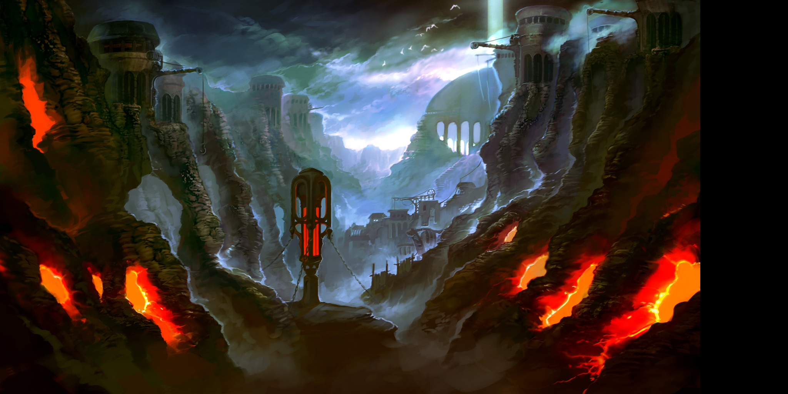
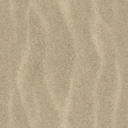
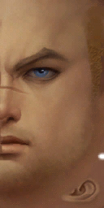
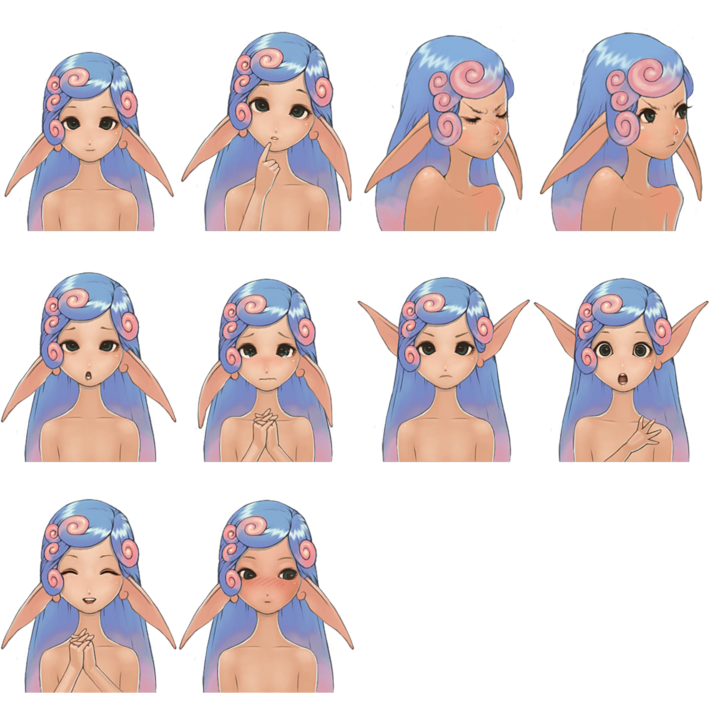

Some months ago, I bought a 3D printer with my girlfriend to print cool things that we find on the web. We started by printing gifts for our family and friends, including useful house items and characters from several universes. A friend of mine, Joseph, asked if it was possible to do something very specific.

There is this game named AIKA Online, a korean MMORPG that we played a lot in the 2010's. We met there after he inspected my character's profile and found funny that I had Aldebaran, the Rifleman's mount, equipped in a Warrior. It was, indeed, comical, as the Warrior class is tall and muscular, and the mount was built for the small and thin Rifleman, creating a sort of an "elephant in a bicycle" situation.

Joseph asked if it was possible to find 3D models for the characters of that game, which I replied that there aren't much info about the game itself. Sure, AIKA had its popularity, but MMORPGs are already niche enough, and this game never had enough power to break out of the bubble. To make things a bit more complicated, there are tools like Bin Parser or Mesh Viewer, and I needed a more robust tool to visualize and extract the necessary files that my friend wanted.

I then created a program that allowed me to successfully extract meshes and textures for a character, using existing codebases as a start point. However, both tools had problems: Mesh Viewer exported boneless meshes only as COLLADA files (with structural problems), and the JIT converter did not work with newer files that have different magic values.

Being frustrated by old tools for a old forgotten game was enough. So I created a new project that would allow me to open the game client folder and see each file with a click. Using Tauri, I made a simple interface that allowed me to see which files I could open, and what was going wrong with the parser.

Every new file that wasn't able to be opened gave me more curiosity on how the game handles those files. "Why there are many image formats? Why there are file extensions with different letter casings?". What once was a simple project to get a mesh for a character, became a mission to understand what was going on and create the definitive tool.

This article is being written to share my findings with this project, starting with the texture files.

You may ask "why did you code everything by hand and didn't used lib x or y?", and the only answer I have is: because that's the fun part!

# Client files

I'm not going to send a

```
.
├── Ani
├── bgm
├── Effect/
│ └── STextures
├── Env/
│ ├── LTile
│ ├── MTile
│ └── STile
├── Mesh
├── Objects
├── Shader
├── Texture
└── UI
```

What matter for us now is `STextures`, `Env`, `Texture` and `UI`. They contain image files with a `.jit` extension.

# Magic

The first 4 bytes of each texture file contains a magic string that tell us which format the file is stored. Luckily for us there's no encryption on them, and each magic can be directly mapped to the following formats:

- JT20 => TGA
- JT31 and JT41 => DXT1
- JT33 => DXT3
- JT35 => DXT5

There must be an obscure reason on why there are two magic strings that represent `DXT1`.

## TGA

TGA is a image format developed by AT&T EPICenter (which later became Truevision) in 1984, being one of the first image formats that combine several capabilities like true color, transparency and lossless compression. Its simple binary structure made it suitable for video production and 3D rendering, contributing to its widespread adoption in game development.

This is one of the easiest texture format that we can read from AIKA's files. All TGA files in the game are uncompressed. To start, there is a 20-byte header:

| Field name                  | Type   |
| --------------------------- | ------ |
| Magic                       | "JT20" |
| ID length                   | uint8  |
| Color Map Type              | uint8  |
| Data Type                   | uint8  |
| Color Map First Entry Index | uint16 |
| Color Map Length            | uint16 |
| Color Map Entry Size        | uint8  |
| X origin                    | uint16 |
| Y origin                    | uint16 |
| Width                       | uint16 |
| Height                      | uint16 |
| Pixel Depth                 | uint8  |
| Descriptor                  | uint8  |

For our parser, we will ignore most of these values, using only `Width`, `Height`, `Pixel Depth` and `Descriptor`. For each pixel, we read the following bytes:

| Channel                        | Type  |
| ------------------------------ | ----- |
| Blue                           | uint8 |
| Green                          | uint8 |
| Red                            | uint8 |
| Alpha (if `Pixel Depth == 32`) | uint8 |

The <a class="anchor highlight" href="https://github.com/DEAKSoftware/Truevision-TGA">TGA specification</a> has 9 different values for `Data Type`, but we don't need to parse every variant as all the game files contains a value of `2` or `3`.

The bits in the `Descriptor` contains more info about how the image should be built:

| Field                | Bits  |
| -------------------- | ----- |
| Alpha bits per pixel | 1 - 4 |
| Right to left        | 5     |
| Top to bottom        | 6     |
| Unused               | 7-8   |

Remember that we are reading everything as Little Endian, and the `Descriptor` is not different. In this case, if the image has only a right-to-left flag, the descriptor will be `00010000`.

Most files can be parsed at this point. However, I found that there are some textures that are missing some bytes at the end which can potentially crash the program. I tested a lot of files and its usually a black or transparent pixel. In those cases, we can consider that the missing pixel channel is `0` .

See the result for a file named `disceroa.jit`:



As you can see, we successfully converted our first textures without any issues. Sometimes, like in this case, the image does not fill the entire space, creating black or white bars. This is not a problem with our parser, they already exist in the original files.

# DXTC

Originally known as S3 Texture Compression (S3TC), it is a compression format created in 1998 by S3 Graphics to be used in their GPUs, and later introduced in OpenGL and DirectX. AIKA was developed using DirectX 9, so we were going to find files with this compression sooner or later. There are 8 variations to the S3TC algorithm, the first five having the DXT1 through DXT5 codes assigned by Microsoft, and only three of these are used in the game.

All DXTC files from the game have the same header structure:

| Field name | Type   |
| ---------- | ------ |
| Magic      | "JTxx" |
| Width      | u32    |
| Height     | u32    |

The payload contains pixel data stored in blocks, with their size varying depending on the compression. DXT1 has 8-byte blocks, whereas DXT3 and DXT5 both support transparency by having 16-byte blocks. Dividing `Block Size` by `Width` and `Height` gives us how many blocks there are on each row and column, respectively.

## JT31 and JT41 - DXT1

Each block has the following structure:

| Field name    | Type |
| ------------- | ---- |
| Color0        | u16  |
| Color1        | u16  |
| Color Indices | u32  |

We first read `Color0` and `Color1` and parse them as RGBA. They are stored as RGB 565. For each color, we can parse each channel this way:

```rust
let red = (color >> 11) & 31;
let green = (color >> 5) & 63;
let blue = color & 31;

let rgba = RGBA {
	r: (red << 3) | (red >> 2),
	g: (green << 2) | (green >> 4),
	b: (blue << 3) | (blue >> 2),
	a: 255,
};
```

After parsing both colors, we generate a palette containing 3 to 4 RGBA colors. The quantity of colors in the palette depends on a comparison between `Color0` and `Color1` as unsigned integers, as following:

- If $Color0>Color1$ , then:

  $$
  Color2 = (2 * Color1 + Color2) / 3 \\
  Color3 = (Color1 + 2 * Color2) / 3
  $$

- If $Color0 <= Color1$, then:

$$
Color2 = (Color0 + Color1) / 2
$$

In the last case,`Color3` is treated as a transparent black (RGBA(0, 0, 0, 0)).

Then we read the `Color Indices`. There are 16 2-bit number stored in each block, which map directly into indices on the palette. The result pixels will have the colors pointed by these indices. Because DXT1 does not support transparency, all pixels will have a alpha of `255`.



And there it is! We can now see the contents of every texture file that has a JT31 magic.

## JT33 - DXT3

Although this variant supports transparency, its is a bit more simple than the previous one. Each block has the following structure:

| Field name    | Type   |
| ------------- | ------ |
| Alpha bits    | uint64 |
| Color0        | uint16 |
| Color1        | uint16 |
| Color Indices | uint32 |

We start the same way as the DXT1 by reading `Color0` and `Color1` and parsing them as RGBA. This time, we don't need to compare if `ColorO > Color1`, the palette will always have 4 colors, and the calculation the get `Color2` and `Color3` is the same.

What differs now is that, for each pixel, we must read the alpha value contained in `Alpha bits`. for each pixel, we read 4 bits and multiply by 17 to get a 0-255 range.

Here is the result of a file named `CH01010101.jit`:



## JT35 - DXT5

The block layout is exactly the same as DXT3, and the only difference is how transparency is calculated. DXT5 stores the alpha block containing two 8-bit endpoint values and sixteen 3-bit indices, one for each pixel. Those indices select one of 8 possible alpha values that are interpolated between the endpoints.

Similar to how DXT1 has two modes depending if `Color0 > Color1`, DXT5 has two modes for transparency depending on how the endpoints (`alpha0` and `alpha1`) compare:

- If `alpha0 > alpha1` the table will have 8 interpolated values;
- If `alpha0 <= alpha1` the table will have 6 interpolated values, in addition to two extremes: 0 and 255.

To find each interpolated value in the alpha table, we calculate it using weighted average:

$$
\frac{((N - D) * alpha0) + (D * alpha1)}{N}
$$

Where $N$ is the number of steps between and $D$ is the distance between the step that we want to find a value and the endpoint. It should look something like this:

```rust
let alpha0_weight = alpha0 as u16;
let alpha1_weight = alpha1 as u16;

if alpha0 > alpha1 {
  for i in 1..=6 {
    alpha_table[i as usize + 1] = (((7 - i) * alpha0_weight + i * alpha1_weight) / 7) as u8;
  }

} else {
  for i in 1..=4 {
    alpha_table[i as usize + 1] = (((5 - i) * alpha0_weight + i * alpha1_weight) / 5) as u8;
  }

  alpha_table[6] = 0;
  alpha_table[7] = 255;
}
```

To get a pixel's alpha value, we use the 3-bit indices stored after `alpha0` and `alpha1` in the alpha block, like this:

```rust
let alpha_indices = alpha_bits >> 16;

// Then, for each pixel:
let pixel_alpha_index = ((alpha_indices >> (i * 3)) & 7) as usize;
let alpha_table[alpha_bits] = 0;
```

Now the program is able to parse all texture files from the game! See the result of `PranBaby033.jit`:



# Other findings

Map01.jit
map06.jit
Map60.jit
